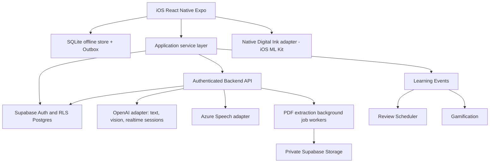

# Mandarin AI — Mobile Technical Architecture v1.2

## Architecture decision record

**Chosen:** iOS-first Expo React Native + TypeScript, Supabase Postgres/Auth/Storage, on-device SQLite, OpenAI API/Realtime, Azure AI Speech pronunciation assessment, Google ML Kit Digital Ink. Cloud persistence with offline-first selected study flows. Android-ready but iOS validated first.

**Style:** Modular monolith + explicit module contracts + ports/adapters, not uncontrolled runtime plugin execution or premature microservices.

**Warning:** Expo Go cannot test all required native integrations; use development builds on an iPhone and later EAS/TestFlight. ML Kit Digital Ink consumes vector touch strokes, whereas PDF/photo import is OCR/document parsing. Azure speech should be evaluated on device through a server-side adapter or viable native integration (don't assume an official React Native SDK). OpenAI real-time credentials must be short-lived and issued via backend.

## Logical components



## Repository structure

```text
mandarin-ai/
  apps/mobile/                         # Expo Router app, iOS first
    app/                               # navigation only
    src/components/                    # shared UI
    src/modules/                       # feature screens/controllers
    src/native/                        # iOS module integration wrappers
  apps/api/                            # backend TS service for privileged AI jobs
  packages/contracts/                  # zod schemas, API types, events
  packages/domain/                     # pure domain rules, SRS, quiz engine
  packages/adapters/                   # interfaces and provider adapters
  packages/design-system/              # tokens and reusable UI
  supabase/migrations/                  # reversible/versioned DB changes
  docs/                                # PRD, ADRs, diagrams, runbooks
  .github/workflows/                    # checks
```

## Layering and dependency rules

- UI modules depend on domain contracts and application interfaces, not on other modules' private table schemas.
- Domain code is pure TypeScript and can run in tests without React Native or cloud APIs.
- External providers implement ports: `AiTutorPort`, `ConversationPort`, `PronunciationAssessmentPort`, `DocumentExtractionPort`, `DigitalInkPort`, `TextToSpeechPort`, `LearningRepository`, `ContentRepository`, `SyncTransport`.
- Versioned `QuizType` registry supports meaning, Pinyin, audio, dictation and handwriting; add quiz types by registration and type-specific renderer/grader.
- Content is sourced from dynamic course/lesson records, never hard-coded into source code.
- Client module registry is a typed code registry controlled by product releases, not remote executable JavaScript.
- Database migrations are reviewed independently; avoid circular module dependencies.

## Database domain model (initial)

### Identity & content
`profiles(id auth.uid FK, settings, created_at)`
`courses(id, owner_id, title, language_level, visibility, latest_version_id)`
`course_versions(id, course_id, version_number, status, source_document_id)`
`chapters(id, course_version_id, ordinal, title)`
`lessons(id, chapter_id, ordinal, title, publication_status)`
`lesson_sections(id, lesson_id, section_type, content_json, source_page_start, source_page_end)`
`source_documents(id, owner_id, storage_key, mime_type, content_hash, access_scope, rights_metadata)`
`document_import_jobs(id, owner_id, source_document_id, status, progress, error_code, retry_count)`

### Lexicon, Hanzi history
`lexemes(id, simplified, traditional, normalized_pinyin, sense_key, source_provenance)`
`lexeme_senses(id, lexeme_id, lang, gloss, source)`
`hanzi_characters(id, glyph, variant_type, meaning)`
`hanzi_historical_forms(id, character_id, script_stage, attestation_reference, media_id, review_status)`
`hanzi_media(id, storage_key, media_type, license, source)`
`lexeme_characters(lexeme_id, character_id, position)`
`lesson_lexemes(id, lesson_id, lexeme_id, source_page, context_json)`
`user_lexemes(user_id, lexeme_id, first_seen_at, notes, mastery_state, UNIQUE(user_id,lexeme_id))`
`user_lexeme_tags(user_id, lexeme_id, tag_id)`

### Study and review
`study_sessions(id, user_id, started_at, completed_at, source_context)`
`quiz_sessions(id, user_id, mode, state, started_at, completed_at)`
`quiz_attempts(id, quiz_session_id, user_id, lexeme_id, quiz_type, response_json, correct, created_at, idempotency_key UNIQUE)`
`writing_attempts(id, quiz_attempt_id, stroke_data_key, recognition_json, feedback_json)`
`listening_attempts(id, user_id, lexeme_id, prompt_id, answer_json, created_at)`
`speaking_attempts(id, user_id, reference_text, assessment_json, recording_key nullable, created_at)`
`review_cards(id, user_id, lexeme_id, srs_state_json, due_at, last_reviewed_at, UNIQUE(user_id, lexeme_id))`
`xp_ledger(id, user_id, source_event_id UNIQUE, points, created_at)`
`achievements(id, code, description)` / `user_achievements(user_id, achievement_id, achieved_at)`
`notifications_preferences(user_id, timezone, quiet_hours, enabled)`
`learning_events(id, user_id, event_type, event_version, payload_json, occurred_at, idempotency_key UNIQUE)`
`sync_operations(id, user_id, operation_id UNIQUE, client_device_id, entity_type, status, server_version)`

### Security and constraints
- RLS enabled on **all** learner-scoped tables; user can only read/write their own records. Shared curated lexicon/history are read-only for normal users.
- Validate upload ownership and authorization in backend and storage policy; avoid client-supplied privileged IDs.
- Use foreign keys and unique constraints, especially `user_lexemes` and idempotency keys.
- Store audio/PDF in private buckets, expose only authorized signed URLs with limited lifespan.
- Encrypt/treat personal recordings and notes as sensitive learner data; implement retention and deletion jobs.

## Offline synchronization protocol

1. Local SQLite is read model for downloaded lesson content, vocabulary, due reviews, local attempts and outbox.
2. Each offline mutation gets ULID/UUID, device ID, user ID, schema version, logical timestamp, and immutable event payload.
3. UI writes local state plus outbox entry atomically.
4. On network restoration, sync worker sends bounded idempotent batches with auth; server verifies ownership, dedupes and acknowledges canonical versions.
5. Use append-only attempts/learning events for conflict-free review history. Server deterministically replays SRS state in causal order. For editable notes, use server revision / conflict UI or explicit last-write-wins policy only after documented decision.
6. Downloads use per-user cursor/updated_at + tombstones; deletion and logout purge appropriate local data.
7. Re-run after interruptions without double XP or lost attempts; local audio remains local until approved upload.

## PDF ingestion and provenance

`uploaded -> validating -> extracting -> structuring -> awaiting_review -> published` (plus failed/cancelled).

- Text-layer extraction first; OCR/vision if scanned.
- Preserve document page/source span and confidence on each extracted item.
- Structured model output is a draft; user approves and edits before publication.
- Normalize Hanzi/Pinyin with language-aware checks; use sense-aware lexeme matching.
- Import by content hash + course version; retries idempotent and never overwrite learner edits.
- Queue chunked processing with caps for file size/pages/cost and observable failures.
- Initially documents are private; licensing and public reuse require explicit authorization.

## AI provider boundaries

- **OpenAI:** grammar/example/quiz draft generation, document understanding and optional real-time role-play. Validate JSON schemas, constrain lesson scope and cost.
- **Azure AI Speech:** reference-based pronunciation evaluation (zh-CN); test scores/available dimensions and Vietnamese user accents on real devices before enabling any definitive tone judgement.
- **Google ML Kit Digital Ink:** iOS native bridge receives coordinate/timestamp strokes, downloads correct language model, returns candidate Hanzi; test model licensing and packaging/deployment. Not photo OCR.
- **Text-to-Speech:** configurable provider (Azure or OpenAI); cache reusable voice assets where licensing permits. No need to make a premature exclusive choice.

## Platform and release

- iOS minimum version decided after latest Expo, ML Kit and Azure integration compatibility matrix is tested.
- Expo EAS Development Build from first native-integration milestone, not only Expo Go.
- TestFlight private beta -> staged App Store release after privacy and safety review.
- CI: lint, TypeScript, unit, integration with Supabase policies, migration checks, mobile build, end-to-end smoke tests on actual iPhone.
- Feature flags for incomplete features; release should not represent mocked AI responses as production.
- Keep Android compatibility in shared logic; postpone Android native bridge validation and Play distribution to a separate release gate.

## Architecture acceptance probes

1. Add a new `QuizType` and renderer without modifying old question graders; regression suite remains green.
2. Add a new course from PDF without app code edit and without duplicating a known lexeme.
3. Swap mock OpenAI/Azure/Ink adapters for live ones in integration tests without changing domain code.
4. Offline quiz -> process killed -> reopen -> reconnect -> exactly one server attempt, correct next review, one XP grant.
5. User A cannot read user B documents, attempts, audio or dictionary even with guessed UUIDs.
6. Failed PDF import can resume/retry; published course is not partially corrupted.
