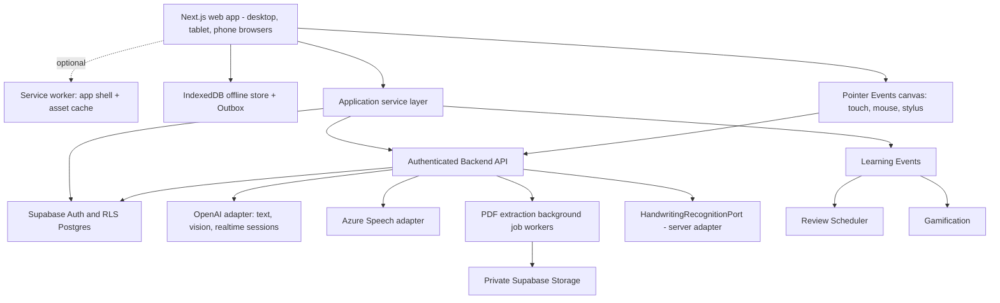

# Mandarin AI — Technical Architecture v2.1 (cross-platform web)

> v2.1 (D-028): Mandarin AI is a cross-platform web application for desktop, laptop, tablet and smartphone browsers (Chrome, Edge, Firefox, Safari on Windows, macOS, iOS, Android). PWA install, offline and Web Push are progressive enhancements. v2.0 moved the client from React Native/Expo to Next.js (D-018 … D-027). v1.3 incorporated owner decisions D-001 … D-013. The authoritative decision log is `docs/DECISIONS.md`; this document describes the resulting architecture.

## Architecture decision record

**Chosen:** Next.js (App Router) + TypeScript + Tailwind CSS responsive web app (mobile-first CSS, dedicated tablet and desktop layouts) for modern Chrome, Edge, Firefox and Safari; optional PWA layer (manifest + Serwist service worker); Supabase Postgres/Auth/Storage; IndexedDB (Dexie) offline store + outbox with idempotent sync, with in-memory fallback when unavailable; separately deployed Fastify Node.js API and background PDF worker (Railway candidate, no host-specific APIs in domain logic); OpenAI API (turn-based first, Realtime gated); Azure AI Speech via the API; handwriting recognition through `HandwritingRecognitionPort` (server-side adapter by default, D-029). pnpm workspaces + Turborepo monorepo.

**Style:** Modular monolith + explicit module contracts + ports/adapters, not uncontrolled runtime plugin execution or premature microservices.

**Warnings:** Every core feature must work in a normal browser tab without installation; browser capabilities (microphone, AudioWorklet, IndexedDB, service worker, Web Push, file APIs) are feature-detected at runtime, never assumed by user-agent. Browser differences that shape the design are listed in the browser constraints section (Safari and Firefox have no Background Sync; Web Push on iOS/iPadOS only works for Home-Screen apps; MediaRecorder output formats differ between engines; private browsing can block or limit IndexedDB). Handwriting recognition consumes vector strokes; PDF/photo import is OCR/document parsing. OpenAI Realtime credentials must be short-lived and issued via the backend.

## Logical components



## Repository structure

```text
mandarin-ai/
  apps/web/                            # Next.js App Router web app (responsive: phone / tablet / desktop), optional PWA
    app/                               # routes/layouts only
    src/modules/                       # feature modules (dictionary, practice, library, …)
    src/components/                    # shared UI (Tailwind)
    src/offline/                       # IndexedDB schema (Dexie), outbox, sync engine, in-memory fallback
    src/platform/                      # capability detection + browser adapters: canvas, audio capture, file upload, push
    src/sw.ts                          # Serwist service worker source
    public/manifest.webmanifest        # PWA manifest + icons
  apps/mobile/                         # LEGACY M0 native spike (Expo) — frozen, removed after M0-PWA approval
  apps/api/                            # Node.js TS service: privileged AI calls, auth-checked
                                       #   (PDF worker entrypoint added in M4, same codebase)
  packages/contracts/                  # zod schemas, API types, events, QuizType ids, skills
  packages/domain/                     # pure domain rules, SRS, quiz engine, QuizType registry
  packages/adapters/                   # ports and provider adapters (mock adapters labelled MOCK)
  packages/design-system/              # tokens and reusable UI (created when first UI lands, M1+)
  packages/config/                     # shared tsconfig / lint presets
  supabase/migrations/                 # versioned DB changes
  supabase/tests/                      # SQL/RLS tests
  docs/                                # PRD, DECISIONS.md, FEATURES.md, checklists, runbooks
  .github/workflows/                   # checks

Package dependency direction (no cycles, enforced by lint/CI): `contracts` <- `domain` <- `adapters` <- `apps/*`. `contracts` depends on nothing internal; `domain` depends only on `contracts`; `adapters` on `contracts` (+ `domain` types); apps may depend on all packages, packages never depend on apps.
```

## Layering and dependency rules

- UI modules depend on domain contracts and application interfaces, not on other modules' private table schemas.
- Domain code is pure TypeScript and can run in tests without a browser, React or cloud APIs.
- External providers implement ports: `AiTutorPort`, `ConversationPort`, `PronunciationAssessmentPort`, `DocumentExtractionPort`, `HandwritingRecognitionPort` (was `DigitalInkPort`), `TextToSpeechPort`, `LearningRepository`, `ContentRepository`, `SyncTransport`.
- Versioned `QuizType` registry with exactly six initial types: `meaning_recognition`, `hanzi_recognition`, `pinyin_matching`, `audio_recognition`, `dictation`, `handwriting` (D-002). Each registration declares `id`, `version`, trained `skill`, answer schema and grader; renderers register on the client. Add quiz types by registration plus a type-specific renderer/grader.
- Skill mapping (D-007): `meaning_recognition`, `hanzi_recognition`, `pinyin_matching` -> `meaning`; `audio_recognition`, `dictation` -> `listening`; `handwriting` -> `writing`; speaking practice (not a `QuizType`) -> `speaking`.
- Content is sourced from dynamic course/lesson records, never hard-coded into source code.
- Client module registry is a typed code registry controlled by product releases, not remote executable JavaScript.
- Database migrations are reviewed independently; avoid circular module dependencies.

## Database domain model (initial)

This is the target model. M0 ships only the migration template and the `profiles` baseline with RLS tests; the remaining tables are created by reviewed migrations in M1 (identity/sync), M2 (lexicon, vocabulary, tags/topics, course/library), M3 (quiz/review) and later milestones.

### Identity & content
`profiles(id auth.uid FK, settings, created_at)`
`courses(id, owner_id, title, language_level, visibility, latest_version_id)`
`course_versions(id, course_id, version_number, status, source_document_id)`
`chapters(id, course_version_id, ordinal, title)`
`lessons(id, chapter_id, ordinal, title, publication_status)`
`lesson_sections(id, lesson_id, section_type, content_json, source_page_start, source_page_end)`
`source_documents(id, owner_id, storage_key, mime_type, content_hash, access_scope, rights_metadata)`
`document_import_jobs(id, owner_id, source_document_id, status, progress, error_code, retry_count)`

`import_batches(id, owner_id, document_import_job_id NULL, kind, status, created_at)` — groups words added by one import or bulk action.
`content_admins(user_id PK)` — users allowed to curate shared content (checked by `is_content_admin()` in RLS).

### Shared lexicon (canonical, D-001)
Read-only for normal users; written only by `service_role` (import pipeline / API) or `content_admins`.
`lexemes(id, simplified, traditional, pinyin_display, normalized_pinyin, sense_key, source_provenance, UNIQUE(simplified, normalized_pinyin, sense_key))`
`lexeme_senses(id, lexeme_id FK, lang, gloss, source)`
`hanzi_characters(id, glyph, variant_type, meaning)`
`hanzi_historical_forms(id, character_id, script_stage, attestation_reference, media_id, review_status)`
`hanzi_media(id, storage_key, media_type, license, source)`
`lexeme_characters(lexeme_id, character_id, position)`
`lesson_lexemes(id, lesson_id, lexeme_id FK NULL, custom_lexeme_id FK NULL, source_page, context_json, CHECK exactly one of lexeme_id/custom_lexeme_id)` — `custom_lexeme_id` is only allowed in lessons of a private course owned by the same user (enforced by trigger + RLS).

### User-owned vocabulary (D-001, D-006)
All rows carry `user_id`/`owner_id`; RLS: owner only. Composite foreign keys `(id, user_id)` guarantee that link tables never mix two users' rows.
`custom_lexemes(id, owner_id, simplified, traditional, pinyin_display, normalized_pinyin, gloss_vi, example, suggested_lexeme_id FK lexemes NULL, created_at, updated_at, UNIQUE(owner_id, simplified, normalized_pinyin, gloss_vi), UNIQUE(id, owner_id))`
`vocabulary_items(id, user_id, lexeme_id FK NULL, custom_lexeme_id NULL, notes, mastery_state, first_seen_at, CHECK exactly one of lexeme_id/custom_lexeme_id, FK (custom_lexeme_id, user_id) -> custom_lexemes(id, owner_id), UNIQUE(user_id, lexeme_id), UNIQUE(user_id, custom_lexeme_id), UNIQUE(id, user_id))` — the learner's personal dictionary entry; replaces `user_lexemes`.
`vocabulary_additions(id, user_id, vocabulary_item_id, study_date DATE, lesson_id FK NULL, source_document_id FK NULL, import_batch_id FK NULL, source_page NULL, entry_method ENUM(manual, pdf_import, image_import, text_import, starter_fixture), created_at, idempotency_key UNIQUE, FK (vocabulary_item_id, user_id) -> vocabulary_items(id, user_id))` — one row per time a word is added/encountered; provenance trail.
`topics(id, owner_id, name, created_at, UNIQUE(owner_id, lower(name)), UNIQUE(id, owner_id))`
`tags(id, owner_id, name, color NULL, created_at, UNIQUE(owner_id, lower(name)), UNIQUE(id, owner_id))`
`vocabulary_item_topics(user_id, vocabulary_item_id, topic_id, PK(vocabulary_item_id, topic_id), composite FKs on (id, user_id))`
`vocabulary_item_tags(user_id, vocabulary_item_id, tag_id, PK(vocabulary_item_id, tag_id), composite FKs on (id, user_id))`
`vocabulary_addition_topics(user_id, vocabulary_addition_id, topic_id, PK(...))` — topic chosen at entry time.

### Study and review
`study_sessions(id, user_id, started_at, completed_at, source_context)`
`quiz_sessions(id, user_id, mode, state, started_at, completed_at)`
`quiz_attempts(id, quiz_session_id, user_id, vocabulary_item_id, quiz_type, quiz_type_version, skill, response_json, correct, created_at, idempotency_key UNIQUE, UNIQUE(id, user_id))`
`writing_attempts(id, quiz_attempt_id, stroke_data_key, recognition_json, feedback_json)`
`listening_attempts(id, user_id, vocabulary_item_id, quiz_attempt_id NULL, prompt_id, answer_json, created_at)`
`speaking_attempts(id, user_id, vocabulary_item_id NULL, lesson_id NULL, quiz_attempt_id NULL, reference_text, provider, provider_status, assessment_json, recording_key NULL, created_at, idempotency_key UNIQUE)` (D-008; nullable links because free-form role-play has no item/lesson; composite FKs on `(id, user_id)` keep links within the same user)
`review_cards(id, user_id, vocabulary_item_id, skill ENUM(meaning, writing, listening, speaking), srs_algorithm, srs_state_json, due_at, last_reviewed_at, UNIQUE(user_id, vocabulary_item_id, skill))` (D-007; one schedule per skill, never duplicated)
`xp_ledger(id, user_id, source_event_id UNIQUE, points, created_at)` — created and populated from `learning_events` in M7 (D-003); M3 writes events only.
`achievements(id, code, description)` / `user_achievements(user_id, achievement_id, achieved_at)`
`notifications_preferences(user_id, timezone, quiet_hours, enabled)`
`push_subscriptions(id, user_id, endpoint UNIQUE, p256dh, auth, user_agent, created_at, last_success_at, revoked_at)` — Web Push (VAPID) subscriptions, owner-only RLS (D-024, M7)
`learning_events(id, user_id, event_type, event_version, payload_json, occurred_at, idempotency_key UNIQUE)`
`sync_operations(id, user_id, operation_id UNIQUE, client_device_id, entity_type, status, server_version)`

### Security and constraints
- RLS enabled on **all** learner-scoped tables; user can only read/write their own records. Shared curated lexicon/history are read-only for normal users.
- Validate upload ownership and authorization in backend and storage policy; avoid client-supplied privileged IDs.
- Use foreign keys and unique constraints, especially `vocabulary_items`, `review_cards(user_id, vocabulary_item_id, skill)` and idempotency keys.
- Normal users have SELECT-only access to shared lexicon/Hanzi tables; INSERT/UPDATE/DELETE require `service_role` or `is_content_admin()`.
- Store audio/PDF in private buckets, expose only authorized signed URLs with limited lifespan.
- Encrypt/treat personal recordings and notes as sensitive learner data; implement retention and deletion jobs.

## Offline synchronization protocol

1. Local IndexedDB (Dexie) is the read model for downloaded lesson content, vocabulary, due reviews, local attempts and the outbox (D-021). `navigator.storage.persist()` is requested; the UI shows unsynced operation count and warns before logout. Stored data is minimal: **no API secrets, refresh tokens or sensitive audio in IndexedDB** (D-022, approved with conditions). Optional Web Crypto AES-GCM field encryption with a non-extractable key is a defence against casual file access only and must not be described as equivalent to native Keychain/SQLCipher. Sessions are handled by Supabase Auth (`@supabase/ssr`); provider secrets never reach the browser. Raw audio is not persisted locally beyond a pending upload the learner approved.
2. Each offline mutation gets ULID/UUID, device ID, user ID, schema version, logical timestamp, and immutable event payload.
3. UI writes local state plus outbox entry atomically (single IndexedDB transaction).
4. Sync runs on app start, `online`, `visibilitychange` (visible), end of each study session and a timer while the app is open (Safari and Firefox have no Background Sync API). It sends bounded idempotent batches with auth; server verifies ownership, dedupes by `operation_id`/`idempotency_key` and acknowledges canonical versions. A Web Lock (or IndexedDB lease) prevents two tabs syncing at once.
5. Use append-only attempts/learning events for conflict-free review history. Server deterministically replays SRS state in causal order. For editable notes, use server revision / conflict UI or explicit last-write-wins policy only after documented decision.
6. Downloads use per-user cursor/updated_at + tombstones; deletion and logout purge appropriate local data.
7. Re-run after interruptions without double XP or lost attempts; local audio remains local until approved upload.

## PDF ingestion and provenance

`uploaded -> validating -> extracting -> structuring -> awaiting_review -> published` (plus failed/cancelled).

- Text-layer extraction first; OCR/vision if scanned.
- Preserve document page/source span and confidence on each extracted item.
- Structured model output is a draft; user approves and edits before publication.
- Normalize Hanzi/Pinyin with language-aware checks; use sense-aware lexeme matching.
- Import by content hash + course version; retries idempotent and never overwrite learner edits.
- Queue chunked processing with caps for file size/pages/cost and observable failures.
- Initially documents are private; licensing and public reuse require explicit authorization.

## AI provider boundaries

- **OpenAI:** grammar/example/quiz draft generation, document understanding and role-play. Turn-based voice first; Realtime only after an on-device stability proof (D-004). M0 performs a feasibility/auth spike only: the API mints short-lived Realtime client secrets for authenticated users; mocked responses are always labelled `MOCK` and never reported as live.
- **Azure AI Speech:** reference-based pronunciation evaluation (zh-CN) through `apps/api`; the browser records PCM via `AudioWorklet` and sends 16 kHz mono WAV (D-023); test scores/available dimensions and Vietnamese user accents on real devices before enabling any definitive tone judgement.
- **Handwriting recognition (D-020, D-029):** a Pointer Events canvas captures (x, y, t) strokes from touch, mouse or pen; strokes are sent to `apps/api` where a `HandwritingRecognitionPort` adapter returns candidates. Default adapter: HanziLookup matcher with Make Me a Hanzi–derived data, run server-side only (GPL-3 code / Arphic PL data — owner licence approval pending, D-029). Target-aware stroke matching (Hanzi Writer data) after submission is an optional complement. No quality claim before measured top-1/top-5 on real handwriting samples from phone, tablet and desktop. Unofficial endpoints are not used.
- **Text-to-Speech:** configurable provider (Azure or OpenAI); cache reusable voice assets where licensing permits. No need to make a premature exclusive choice.

## Platform and release

- Client: Next.js 16 web app, `output: 'standalone'`, served over HTTPS (Railway candidate, D-026).
- **Browser support policy (D-028):** latest two major versions of Chrome, Edge and Firefox on Windows/macOS/Android/Linux, Safari on macOS, and Safari/WebKit on iOS/iPadOS (current and previous major iOS). Older browsers get a readable "unsupported browser" notice rather than a broken app.
- **Responsive layouts (D-030):** phone (< 768 px): single column + bottom tab bar; tablet (768–1279 px): navigation rail + two-pane where useful (list + detail, canvas + reference); desktop (≥ 1280 px): persistent sidebar, multi-pane content, keyboard shortcuts, hover states. Breakpoints are Tailwind tokens shared by all modules. Each module defines its desktop composition explicitly.
- **Progressive enhancement:** PWA manifest, service worker, install prompt, offline mode and Web Push are layered on top; if unsupported (or blocked by private browsing/enterprise policy) the online app still works fully and the UI explains what is unavailable.
- Distribution: private beta at an HTTPS URL with invite-only accounts; no app stores.
- CI: lint, TypeScript, unit (Vitest + fake-indexeddb), integration with Supabase policies, migration checks, `next build`, Playwright E2E on **Chromium, Firefox and WebKit** at mobile, tablet and desktop viewports. Manual verification on real iPhone Safari and at least one real desktop browser before acceptance (`docs/RELEASE_CHECKLIST.md`).
- Feature flags for incomplete features; release must not represent mocked AI or recognition results as production.
- Legacy `apps/mobile` (Expo) is frozen and removed only after M0-PWA approval (`docs/MIGRATION_M0_PWA.md`).

## Browser constraints (design inputs)

| Constraint | Affected | Design response |
|---|---|---|
| No Background Sync / Periodic Sync | Safari, Firefox | Sync on open/online/visibility/session end in every browser; show pending count |
| IndexedDB/Cache may be unavailable or evicted (private mode, quota, inactivity) | all, esp. Safari | Feature-detect; in-memory fallback with "offline unavailable" notice; `storage.persist()` when supported; server is source of truth |
| Installed web app has separate storage from the browser tab | iOS/iPadOS Home Screen | Login and offline download happen in the context the learner uses; sync reconciles |
| Magic links open the default browser, not an installed app | iOS Home Screen, desktop installs | E-mail OTP code / password (D-025) |
| Web Push availability differs | iOS ≥ 16.4 Home Screen only; supported in Chrome/Edge/Firefox desktop & Android | Push where available + in-app reminders everywhere (D-024) |
| `MediaRecorder` formats differ (Safari AAC/MP4, Chrome/Firefox WebM/Opus) | all | AudioWorklet PCM → WAV 16 kHz on every browser (D-023); fallback transcoding on API |
| getUserMedia and service workers need a secure context | all | HTTPS everywhere; localhost for development |
| Microphone permission UX differs; may be re-asked or blocked by policy | all | Query permission state where supported, explicit request button, recovery instructions per browser |
| Audio autoplay needs a user gesture | all | Start playback from user actions; `playbackRate` for slow audio |
| Touch gestures (scroll, zoom, edge swipe) vs mouse/pen | phones/tablets | Canvas `touch-action: none`, Pointer Events with `pointerType`, pressure when present |
| `100vh`, on-screen keyboards, notches | phones/tablets | `dvh`, `viewport-fit=cover`, `env(safe-area-inset-*)`, inputs ≥ 16 px |

## Performance architecture (D-032, D-033, D-034)

Budgets, measurement method, baseline and monitoring: `docs/PERFORMANCE.md`. Design rules:

- **Local-first reads:** lesson content, dictionary, review cards and quiz items already downloaded are queried from IndexedDB (Dexie) with indexes designed for the actual queries (e.g. `[userId+dueAt]`, normalized Pinyin, Vietnamese gloss tokens); the network is never on the critical path of a study interaction.
- **Optimistic UI + honest sync state:** local write + outbox entry in one transaction, UI updates immediately; sync status shows `pending`, `rejected`, `error` explicitly and only shows "synced" after server acknowledgement (`applied`/`duplicate`).
- **Bounded caches with versioning:** Cache Storage / IndexedDB caches are keyed by user id + schema/content version, capped by size (checked with `navigator.storage.estimate()`), evicted LRU; the service worker caches only public assets and pages, never authenticated API responses; logout clears the user's caches.
- **Prefetch:** next lesson / due cards prefetched when idle (`requestIdleCallback`), skipped on `Save-Data` or slow connections.
- **Code splitting / lazy loading:** PDF viewer, audio engine (AudioWorklet), Hanzi stroke animation, handwriting UI, Supabase SDK and AI chat UI are loaded with dynamic `import()` only when the feature opens; per-route JS budget enforced in CI.
- **Background jobs:** PDF ingestion and heavy AI generation run in the worker (M4+) with job rows (`status`, `progress`, `attempt`, `idempotency_key`), retry with backoff, client polling or push of progress — no long synchronous HTTP requests.
- **Streaming:** AI text uses streaming responses end-to-end (provider → API → browser); Realtime voice (WebRTC) only behind a feature flag after real-browser tests (D-004).
- **API/database efficiency:** batch endpoints (sync ≤ 100 ops per request already), no N+1 (repository methods load related rows with joins or `IN` lists), every migration ships indexes for its RLS predicates and main queries with `EXPLAIN ANALYZE` on the large test dataset, pooled connections (Supabase pooler / single `pg` pool per API instance), statement timeouts.
- **Region:** API and database colocated in the region chosen by measurement (D-034); static web served from CDN.
- **No paid cache tier** (Redis etc.) until metrics prove the need (D-033).
- **Instrumentation:** `web-vitals` (sampled, anonymous) → API telemetry endpoint; Fastify `responseTime` + `Server-Timing`; `pg_stat_statements`; AI first-token and pronunciation timings; sync duration, outbox length, error rate.
- **Safety first:** no optimisation may bypass JWT/RLS checks, cache private data in shared caches, drop offline data or weaken idempotent sync.

## Architecture acceptance probes

1. Add a new `QuizType` and renderer without modifying old question graders; regression suite remains green.
2. Add a new course from PDF without app code edit and without duplicating a known lexeme.
3. Swap mock OpenAI/Azure/handwriting adapters for live ones in integration tests without changing domain code.
4. Offline quiz -> browser tab/installed app killed -> reopen -> reconnect -> exactly one server attempt, correct next review, one XP grant (M7).
7. The same account's progress written on a desktop browser appears on a phone browser after sync, and vice versa.
8. Performance budgets in `docs/PERFORMANCE.md` are measured on an HTTPS deployment (lab profiles + real devices) and reported per milestone; regressions beyond the failure threshold block acceptance.
5. User A cannot read user B documents, attempts, audio or dictionary even with guessed UUIDs.
6. Failed PDF import can resume/retry; published course is not partially corrupted.
